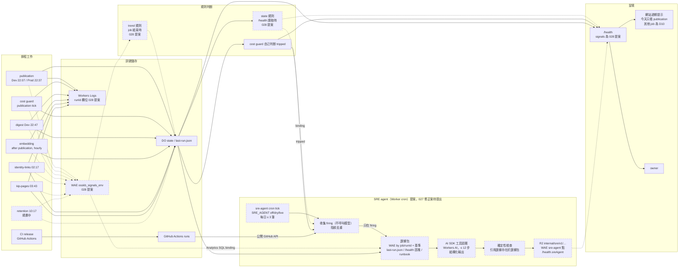

# SRE 訊號地圖

狀態：討論用（2026-10-22）。這份文件不做決定，只把三件事放在一起看：系統今天發出哪些訊號、規則怎麼判斷、SRE agent 在規則 `firing` 之後看什麼、產出什麼。
規格出處：Spec 028 觀測訊號（PR #108，未合併，`docs/specs/028-observability-signals/spec.md`）、Spec 027 SRE agent 與 Amendment (1)（PR #106，未合併，`docs/specs/027-sre-agent/spec.md`）、Spec 026 cost guard、Spec 029 R2 retention。
Spec 027 與 028 還不在 `main`，下文以「§ 小節（行號）」引用 PR 分支上的版本（028 為 `114b5f4`，027 為 `283f131`）。程式碼行號以 `origin/main` `1de3898` 為準。

## 一句話

每個排程工作（job）把自己的結果寫進 `/health`（今天已有），Spec 028 再讓每次執行多寫一筆 Workers Analytics Engine（WAE）資料點並在 Worker 內用固定門檻判斷，結果放在 `/health.signals`（提案中）。SRE agent 只在某條規則為 `firing`（或 cost guard `tripped`、CI 失敗）時才啟動，讀固定範圍的證據，寫一筆診斷到自己的 R2 key、WAE 點與 `/health.sreAgent`；它不偵測、不寫其他 job 的資料、不暫停任何東西。依 owner 2026-10-22 的決定，agent 是 data Worker 上的 `sre-agent` cron job（提案，Spec 027 修正案待提出）。

## 狀態標記

| 標記 | 意思 |
| --- | --- |
| **今天已有** | 在 `origin/main` 的程式碼裡，且 2026-10-22 12:05 UTC 讀 Dev／Prod `/health` 看得到 |
| **028 提案** | Spec 028（PR #108）描述，未實作；需要 slice 0（Wrangler ≥ 4.145.0）與 slice 1 |
| **027 提案** | Spec 027 Amendment (1)（PR #106）描述，未實作 |
| **規劃中** | 規格已合併但未實作（Spec 029 retention），或排程尚未設定 |

名詞：
- **state 規則**：讀 `/health` 時，用 Durable Object（DO）或 `last-run.json` 裡的「目前狀態」直接判斷，不查歷史。
- **analytics 規則（trend 規則）**：每個 job 執行結束時，用 Analytics SQL binding 查自己過去 ≤ 7 筆 WAE 資料點，結果存進該 job 原本就會寫的狀態紀錄。`/health` 本身從不查 WAE（028 Behavior 18，行 350）。
- **`runId`**：`<job>-<startedAt>`（例：`publication-2026-10-20T22-07-00-000Z`），同一次執行的資料點、log、（日後）span 都帶它（028 Behavior 2，行 228）。今天程式碼裡沒有這個欄位（Dev `/health` `lastRun.runId` 不存在）。

## A. 訊號清單

今天 `/health` 由 [`mergeHealth`](../../apps/data-publisher-worker/src/index.ts)（`index.ts:257`）把 DO 狀態與各 job 的 `last-run.json` 合成一份 JSON；`costGuard` 只在 `COST_GUARD` 設定時出現（`index.ts:212`、`:281`），`identityLinks`／`kipPages` 只在各自旗標設定時出現（`index.ts:422–426`）。Workers Logs 在 Dev 與 Prod 都開著，traces 關著（`wrangler.development.jsonc:11–14`、`wrangler.production.jsonc:11`）。log 今天是樣板字串，沒有 `runId`（例：`pipeline.ts:208`、`index.ts:167`、`index.ts:590`）。

| Job（WAE `job`） | 排程（UTC） | 訊號來源 → 存放處 | 欄位 | 狀態 |
| --- | --- | --- | --- | --- |
| `publication`（Dev） | `7 22 * * *`（`wrangler.development.jsonc:44`） | `PipelineState` DO → `/health` `lastRun`、`sources`、`running`、`scheduled`、`followUp`、`phase` | `ok`、`completedAt`、`copiedObjectCount`、`reusedObjectCount`、`pollTruncated`、`r2 {classA, classB}`、`sources[*] {ok, lastSuccessAt}` | **今天已有**（Dev 2026-10-21 22:07 `ok`，`classA` 1,092 = 1,089 + 3） |
| | | WAE 資料點 `osskb_signals_dev`：`indexes [runId]`、`blobs [job, env, status, sourceRunId]`、`doubles [ok, durationMs, r2ClassA, r2ClassB, r2Counted, completedAtMs, c1..c6]`；c1–c6 = github／mail／jira ok、`pollTruncated`、copied、reused（028 Behavior 13，行 289） | 同左 | **028 提案** |
| | | Workers Logs：`publication ${name} at …ms {…}`（`pipeline.ts:208`） | 自由文字 | **今天已有**；改成 `{message, runId, job}` 物件是 **028 提案**（Behavior 8，行 276） |
| `publication`（Prod） | `37 22 * * *`（`wrangler.production.jsonc:21`） | 同 Dev，`osskb_signals_prod` | 同上 | DO／`/health`／Logs **今天已有**（Prod 2026-10-21 22:37 `ok`）；WAE **028 提案**（Prod 在 Dev 一週 OB20 之後） |
| `digest`（Dev） | `47 22 * * *`（`DIGEST_CRON`） | `DigestRun` DO → `/health` `digest {enabled, running, scheduled, today, lastRun}` | `lastRun {ok, completedAt, durationMs, candidates, rejections}` | **今天已有**（Dev 2026-10-21 22:49 `ok`，86 s）；Prod 沒有 digest |
| | | WAE：c1 `candidates`、c2 rejections 合計，`sourceRunId` = 當晚 publication，`r2Counted` 0（D8） | 同左 | **028 提案** |
| `cost-guard`（Dev） | 跟 publication 同一個 tick（22:07），`COST_GUARD=monitor` | `COST_GUARD_STATE` → `/health` `costGuard {mode, status, reason, checkedAt, metrics, breaker}` | `status` `ok`/`warn`/`tripped`/`unconfigured`/`pending`、`breaker {tripped, metric, value, threshold, trippedAt}` | **今天已有**（Dev `monitor`，`tripped` since 2026-10-21 22:07:14，`r2ClassA` 月累計）；Prod 未設定（`costGuard` 不出現） |
| | | WAE：自己的 `cost-guard-…` 點，c1 breaker、c2–c3 `budget` 金額、c4 Class A 24 h spike | 金額欄位等 Spec 026 修正案（CG21–CG37）落地前為 0 | **028 提案** |
| `identity-links`（Dev） | `17 2 * * *`（`IDENTITY_LINKS_CRON`） | R2 `last-run.json` → `/health` `identityLinks {lastRun, lastGoodAt}` | `lastRun {ok, status, at, durationMs, links, rejected, people, bytesWritten, r2}` | **今天已有**（Dev 2026-10-22 02:17 `ok`，4.7 s）；Prod 未設定 |
| | | WAE：c1–c4 links／rejected／people／bytes，`r2Counted` 1 | 同左 | **028 提案** |
| `kip-pages`（Dev） | `43 3 * * *`（`KIP_PAGES_CRON`） | R2 `last-run.json` → `/health` `kipPages {revision, lastRun, lastGoodAt}` | `lastRun {ok, status (ok/unchanged/failed/over-budget), at, durationMs, requests, jiraRequests, pagesRead, pagesChanged, r2, error}` | **今天已有**（Dev 2026-10-22 03:43 `ok`，5.9 s）；Prod 未設定 |
| | | WAE：c1–c5 pagesRead／pagesChanged／issuesRead／requests／bytes，`r2Counted` 1 | 同左 | **028 提案** |
| `embedding`（Dev） | 每次 publication 成功後；仍有待處理 chunk 時每小時一次（`SEARCH_EMBEDDING=bge-m3@1`） | `SearchEmbeddingRun` DO → `/health` `searchEmbedding {lastRun, lastError, today, …}` | `lastRun {ok, durationMs, embeddedThisRun, pending, quarantined, deletedThisRun, …}` | **今天已有**（Dev）；Prod 未啟用 |
| | | WAE：c1–c4 embedded／pending／quarantined／deleted，`r2Counted` 0（D8） | 同左 | **028 提案** |
| `retention` | `17 10 * * *`（`RETENTION_CRON`，未設定） | `/health` `retention {mode, status, reason, lastRun {runId, deleted, remaining, elapsedMs, r2, failureKind}}` | 同左 | **規劃中**（Spec 029 已合併、未實作；`origin/main` 沒有 retention 程式碼，Dev `/health` 沒有 `retention`） |
| | | WAE：c1–c5 deleted objects／bytes、remaining、candidates、dry run | 同左 | **028 提案**（隨 Spec 029 落地） |
| CI release | push 到 `main`、推 `v*` tag（`.github/workflows/ci.yml:5–7`） | GitHub Actions run：`deploy-development`（`ci.yml:132`）、`deploy-production`（只在 `v*` tag，`ci.yml:252–254`） | `conclusion`、`headSha`、失敗 job 的最後 60 行 | run 本身 **今天已有**；harness 規則 `ci.release` 是 **027 提案**（A1，行 88） |

不在 Spec 028 job 清單內、但今天在 `/health` 的欄位：`reviewQueue`、`githubReviews*`、`searchQuery`。Spec 027 A2（行 116）把 `review-queue` 列為可觸發 job，Spec 028 沒有它的資料點；兩份規格要對齊（見 E）。

## B. 規則

門檻是 Spec 028 D4 的暫定值（行 532），改動要開 PR；規則條目格式為 `{id, source, status: ok|warn|firing|unknown, value, threshold, since, runId}`，缺資料一律 `unknown`，從不 `firing`（Behavior 5，行 264）。`/health.signals.status` 取最差的一條（`unknown` 算 ok，Behavior 7，行 272）。

| 規則 id | 適用 job | 輸入訊號 | warn | firing | 在哪裡判斷 | 狀態 |
| --- | --- | --- | --- | --- | --- | --- |
| `job.missed` | 每個已啟用的日排程 job（publication、digest、cost-guard 以 `checkedAt`、retention、identity-links、kip-pages） | 上一次執行（任何結果）距今多久，讀 `/health` 原本就讀的紀錄 | > 24.5 h | > 27 h；啟用後還沒跑過：27 h 內 `unknown`，之後 `firing` | Worker，`/health` 讀取時（state） | **028 提案**（Behavior 15，行 318） |
| `job.missed`（embedding） | `embedding` | 同上，只在 `pending` > 0 時 | > 2 h | > 3 h | Worker，`/health` 讀取時（state） | **028 提案** |
| `job.failures` | 全部 | 本次與前幾次的 `ok`；`unchanged`、`no-input` 算成功 | 本次失敗 | 連續兩次失敗 | Worker，該 job 執行結束時（analytics） | **028 提案**（Behavior 16，行 328） |
| `job.duration` | 全部 | `durationMs` 與前 7 次中位數（至少 3 次） | > 2 × 中位數 | ≥ 自己宣告的牆鐘預算 80 %（只有 retention 10 min、kip-pages `KIP_PAGES_CRON_WALL_MS`） | Worker，執行結束時 | **028 提案** |
| `job.r2ClassA` | `r2Counted` = 1 的 job（publication、identity-links、kip-pages、retention） | `r2ClassA` 與前 7 次中位數 | > 3 × 中位數且 > 1,000 | > 10 × 中位數且 > 5,000 | Worker，執行結束時 | **028 提案** |
| `r2.classAInvariant` | publication | `lastRun.r2.classA` 與 `copiedObjectCount` | — | `classA > copiedObjectCount + 3` | Worker，state | **028 提案**；同一個比較今天在 runbook 與 027 原始 `get_health`（已撤回）裡，靠人看 |
| `publication.freshness` | publication | now − 最新的 `sources[*].lastSuccessAt` | > 24.5 h（Spec 021） | > 27 h（Spec 010） | Worker，state | **028 提案**；網站的過期提示（Spec 010／011／021）**今天已有**，但只看 publication |
| `source.success` | publication（github、mail、jira 各一條） | 每個 UTC 日最新一筆 | 本次失敗 | 連續兩個 UTC 日失敗 | Worker，analytics | **028 提案**（Behavior 5，行 252） |
| `publication.pollTruncated` | publication | `pollTruncated` 連續為真的時間 | 本次為真 | 持續 > 48 h | Worker，analytics | **028 提案** |
| `digest.freshness` | digest（啟用時） | now − 最新成功的 `completedAt` | — | > 48 h | Worker，state | **028 提案** |
| `digest.rejections`（rejection spike） | digest | 本次 rejections 與前 7 次中位數（至少 3 次） | — | ≥ 10 且 > 3 × 中位數 | Worker，analytics | **028 提案** |
| cost guard `tripped` | cost-guard | `costGuard.status`、`breaker.trippedAt` | （guard 自己的 `warn`） | `status: "tripped"` | Worker（Spec 026 自己判斷；028 只轉述，不重算，Behavior 16） | 判斷 **今天已有**（Dev `monitor`）；作為 agent 觸發條件是 **027 提案** |
| `ci.release` | CI | 最新 `v*` tag 或 `main` 的 CI run | — | `conclusion: failure` | agent harness（確定性程式碼，不是模型） | **027 提案**（A1、Decision 14） |

Spec 028 Example（行 125）用 Dev 2026-10-20 的真實值走過一遍：全部 `ok`；2026-10-13 的每小時執行（`classA` ≈ 8,190、`copiedObjectCount` ≈ 35）會讓 `r2.classAInvariant` 與 `job.r2ClassA` `firing`。

## C. SRE agent

**owner 決定（2026-10-22），Spec 027 修正案待提出，以下全部為提案**：目標是自動化的診斷能力，不從零自建 agent loop。agent 改在 Cloudflare 上跑，是 data Worker 上自己的一個 cron job（`sre-agent`），用 Vercel AI SDK 搭配 Workers AI 執行工具迴圈（見下方「框架與模型」；Claude Agent SDK 不能在 Workers 執行）。Spec 027 原本「MacBook、launchd、在 pi toolkit 上自建 loop、對照 CS329Z HW1」的寫法不再是目標。觸發只看 `firing`、指紋去重、每日上限、唯讀邊界沿用 Amendment (1)（行 86–199）；執行位置、資料讀取方式與輸出位置依新決定改寫。

### 框架與模型（owner 2026-10-22，取代 Anthropic SDK Tool Runner）

- **框架**：Vercel AI SDK（`ai`）：`generateText` + `tool()` + 步數上限 + 結構化輸出；provider 用 `workers-ai-provider`（或 `agents/models/ai-sdk` 的 `createAI`）。理由：免費、與廠商無關，換 provider 只改一行，不綁 Anthropic。
- **模型**：Cloudflare Workers AI，經 `AI` binding，不需 API key。eval 候選：`@cf/zai-org/glm-4.7-flash`（Cloudflare 文件寫明支援多輪 tool calling）、Llama 3.3 70B、Qwen3 30B（後兩者的 tool calling **未驗證**）。eval 後再選定。
- **成本**：模型用量（neurons）算進 Cloudflare $5 overage 預算，也在 cost guard 的 `workersAiNeurons` 指標內。

### 每次 tick 的步驟

| 步驟 | 做什麼 | 來源 |
| --- | --- | --- |
| 0. 旗標與預算 | `SRE_AGENT` `off`／`dry`／`live`；每個 UTC 日最多 3 筆診斷 | owner 2026-10-22；027 Decision 15 |
| 1. 收集 firing（不呼叫模型） | 本環境的 Spec 028 規則（經 binding 讀 DO 狀態與 WAE）、`costGuard.status: "tripped"`、`ci.release`（公開 GitHub API） | 027 A1 第 18 條（行 88），改為本環境 binding |
| 2. 去重 | 指紋 `<env>:<job>:<ruleId>:<since>`；已診斷過的不重診，除非 `runId` 改變且每 UTC 日最多一次；回到 `ok` 再 `firing` 是新的 `since`，即新指紋 | 027 A1 第 19 條（行 104） |
| 3. 沒有 firing | 記 `lastRun`，模型呼叫 0 次，結束 | 027 A1 |
| 4. 證據包 | 每個新 firing：該 job／`runId` 的 WAE 資料點與基準（前幾次）、該 job 的 `last-run.json`、`/health` 對應區塊、依規則 id 選的 runbook 小節 | 027 A2（行 116） |
| 5. 工具迴圈 | AI SDK `generateText`，只有唯讀工具；步數上限 12；結構化輸出 | 027 A4；owner 2026-10-22 |
| 6. 確定性檢查 | 模型引用的每一段證據必須真的出現在證據包裡，否則不採用 | owner 2026-10-22（新增） |
| 7. 寫出 | 診斷寫到自己的 R2 key（`internal/sre/v1/…`）、自己的 WAE 資料點（`job` = `sre-agent`）、`/health.sreAgent` | owner 2026-10-22；取代 027 A3 的本機 `diagnoses.jsonl` |

`warn`、`unknown` 什麼都不啟動（027 Decision 11）。`/health` 沒有 `signals`（今天 Dev、Prod 都是）時不用自己的門檻補判斷，所以在 Spec 028 啟用前 **只有 cost guard `tripped` 與 `ci.release` 能觸發**。

### 每個 job 的證據包（027 A2，行 116–158）

每份都含觸發的規則條目與 `costGuard`（讓「因為 guard 暫停而錯過排程」被解釋，而不是重報）。

| Job | `/health` 區塊 | 額外輸入 |
| --- | --- | --- |
| `publication`（Dev 22:07、Prod 22:37） | `running`、`scheduled`、`followUp`、`phase`、`lastRun {ok, runId, completedAt, copied, reused, r2, pollTruncated}`、`sources` | Prod 部署可能過期時加 CI 狀態 |
| `digest`（Dev 22:47） | `digest.lastRun {ok, runId, completedAt, durationMs, rejections}` | `sourceRunId` 指向的 publication 資料點 |
| `review-queue`（無 cron） | `reviewQueue` | 無 |
| `search-embedding` | `searchEmbedding {lastRun, lastError, today}` | 無 |
| `identity-links`（Dev 02:17） | `identityLinks {lastRun, lastGoodAt}` | 無 |
| `kip-pages`（Dev 03:43） | `kipPages {lastRun, lastGoodAt}` | 無 |
| `retention`（規劃 10:17） | `retention {mode, status, reason, lastRun}` | 無 |
| cost guard | `costGuard {mode, status, reason, checkedAt, metrics, breaker}`（CG27 後加 `budget`） | 觸發當天前後 12 h 其他 job 的資料點 |
| `ci.release` | 無 | 失敗 job 的最後 60 行 |

### 唯讀工具

027 A2 的工具清單在新執行位置下的對應（工具名稱與介面待修正案定）：

| 能力 | 讀什麼 | 備註 |
| --- | --- | --- |
| `/health` 區塊 | 同一 Worker 內的 DO 狀態與 `last-run.json` | 原樣，不加推導門檻（SRE34） |
| WAE 查詢 | Analytics SQL binding，固定模板（某 job 8 天內歷史、以 `runId` 查、觸發時間 ± 12 h 的所有 job） | 模型只選模板與參數，不寫 SQL；binding 不需 token |
| CI 狀態 | 公開 GitHub API | 唯讀 |
| runbook 小節 | 依規則 id 對應的 `docs/runbooks/` 小節 | 如何打包進 Worker 待修正案定 |
| Workers Logs | v1 不讀 | Spec 028 D6 |
| 結構化輸出 | 不讀任何東西 | 結束診斷 |

### 輸出：診斷紀錄

欄位沿用 027 A3（行 161）：`fingerprint`、`env`、`job`、`ruleId`、`since`、`runId`、`verdict`（`explained`／`unexplained`／`inconclusive`）、`cause`、`evidence [{source, quote}]`、`runbook | null`、`ownerAction | null`（給 owner 的文字，沒有工具能執行它）、`model`、`modelCalls`、`costUsd`、`at`。存放處改為 R2 `internal/sre/v1/…`、`sre-agent` 的 WAE 資料點與 `/health.sreAgent`。

### 排程與預算

- 排程時間待修正案定；027 Decision 10 原本建議 00:30 與 11:00 UTC，分別在晚間 job 與清晨 job 之後。
- 健康的一次：0 次模型呼叫。
- 每筆診斷：≤ 12 次模型呼叫；每天 ≤ 3 筆。
- 模型（Workers AI neurons）、Worker 執行、R2 寫入、WAE 寫入與 SQL 查詢全部算在 Cloudflare $5 Workers Paid + $5 overage 預算內，受 cost guard 管控（量待修正案估）。

### 永遠不做

- 不暫停或恢復任何東西，不重設 breaker（由 cost guard 自己決定）。
- 不呼叫 `POST /run` 或任何 `/*/run`、`/cost-guard/*`。
- 不寫其他 job 的 key；只寫 `internal/sre/v1/…`、自己的 WAE 點與 `/health.sreAgent`。
- 不部署、不跑 wrangler；不偵測、不重算 Spec 026／028 門檻；v1 不讀 Workers Logs、不看 traces；不推播通知。
- firing 本身由產品 UI 與 `/health` 呈現；診斷只負責解釋。

### v1 範圍：事件類型 1–4

依 Spec 027 Evidence 的真實事件（行 30）分類；v1 只診斷前四類：

| 類型 | 例子 | 觸發規則 | 版本 |
| --- | --- | --- | --- |
| (1) 沒跑／停滯 | Dev 49 h 沒發布（2026-09-30 → 10-02） | `job.missed`、`publication.freshness`、`digest.freshness`、`publication.pollTruncated` | v1 |
| (2) 重複失敗 | — | `job.failures`、`source.success` | v1 |
| (3) 成本／R2 異常 | R2 Class A 尖峰（2026-10-07 → 10-13） | `r2.classAInvariant`、`job.r2ClassA`、cost guard `tripped` | v1 |
| (4) 發版／CI 壞掉 | `v0.3.0` tag CI 失敗，Prod 沒部署 | `ci.release` | v1 |
| (5) 結果是 ok 但內容錯 | `en` digest 出現中文句子 | 需要新規則 | v2 |
| (6) 結果是 ok 但悄悄變差 | identity links 4 對 28、kip-pages `unparsed` | 需要新規則 | v2 |

`job.duration` 與 `digest.rejections` 會在 `/health.signals` 出現 `firing`，但不屬於上表任何一類；v1 是否診斷它們未定（列入 E）。

### 不變式與 playbook（提案，owner 審閱中）

把診斷規則當成**不變式（invariant）**：每條是一份 markdown playbook，路徑為 `docs/runbooks/sre/<id>.md`；目前只有範例 [`job.missed`](../runbooks/sre/job.missed.md)，其餘 id 為暫定、檔案尚不存在，內容固定六段：陳述、為什麼、證據、硬檢查（如有）、判斷指引、原因 → runbook 小節。

- **硬不變式（hard）**：由程式碼檢查，違反即 `firing`，觸發 agent（v1）。
- **軟不變式（soft）**：agent 每日巡檢時判斷，只回報「疑似」，永不成為 `firing`（v2）。這會放寬 028／027「agent 從不偵測」的原則，**待 owner 確認**。
- 「反應」指診斷、評嚴重度、建議行動，**從不修復**。

| id（暫定） | 類型 | 陳述 | 硬檢查 | 版本 |
| --- | --- | --- | --- | --- |
| [`job.missed`](../runbooks/sre/job.missed.md) | hard | 每個已啟用的 job 在預期間隔內完成一次（日排程 24.5 h warn／27 h firing；embedding 2 h／3 h） | `job.missed`、`publication.freshness`、`digest.freshness`、`publication.pollTruncated` | v1 |
| `job-not-failing-repeatedly` | hard | 沒有 job 或來源連續兩次（兩個 UTC 日）失敗 | `job.failures`、`source.success` | v1 |
| `r2-class-a-bounded` | hard | 每次 publication 的 Class A ≤ 新物件 + 3；各 job Class A 不遠超基準；月累計未觸發 cost guard | `r2.classAInvariant`、`job.r2ClassA`、cost guard `tripped` | v1 |
| `release-ci-green` | hard | 最新 `v*` tag 與 `main` 的 CI 成功，Prod 跑的是最新 tag | `ci.release` | v1 |
| `digest-locale-matches` | soft | 每個語系的 digest 只有該語系文字 | 無（agent 判斷） | v2 |
| `identity-links-stable` | soft | identity links 數量不會無故大幅下降 | 無 | v2 |
| `kip-pages-parsed` | soft | kip-pages 沒有持續增加的 `unparsed` | 無 | v2 |

### 追蹤 agent 表現（提案）

- **指標**：每次 `sre-agent` 執行寫一個 WAE 點：`firings`、`diagnosed`、`model`、`steps`、`toolCalls`、tokens／neurons、`cost`、`durationMs`、`confidence`、`evidenceCheckFailures`。
- **軌跡**：每筆診斷在 R2 存一份以 `runId` 為 key 的小 JSON（證據包、每次 tool call 與結果、最終輸出），加上 AI Gateway 的請求紀錄。不用 Cloudflare traces。
- **品質**：離線 eval 用 4 個真實事件（第 1 案：[`job.missed` 的 Dev 49 h 停滯範例](../runbooks/sre/job.missed.md#worked-example-dev-2026-09-30--10-02-eval-case-1)）做成固定證據包，附預期原因、證據與 runbook，也用來比較模型；線上由 owner 標記（正確／部分／錯誤），標記回流成 eval 案例。owner 在哪裡標記待決（E）。
- **KPI**：正確率、捏造率（引用不存在的證據）、每筆診斷成本、從 `firing` 到診斷完成的時間。

### 規則 → 診斷內容

| 規則 | 診斷要說明什麼 | 證據（工具／欄位） | Runbook |
| --- | --- | --- | --- |
| cost guard `tripped` | 哪個指標、月累計多少、主要來自哪段事件；今天的 publication 是否守住 Class A 不變式；`monitor` 下沒有暫停任何東西。027 Example (1)（行 200）：Dev `r2ClassA` 2,064,777 > 800,000，主要是 10-02..13 conditional put 事件，今天 1,092 = 1,089 + 3；ownerAction「決定 Spec 026 Decision 1（11-01 前重設）」 | `costGuard.breaker`、`lastRun.r2`、WAE ± 12 h | [R2 operations and cost](../runbooks/cloudflare-data-publisher.md#r2-operations-and-cost)、[Cost guard: Read `/health`](../runbooks/cloudflare-data-publisher.md#read-health)、[Reset the breaker](../runbooks/cloudflare-data-publisher.md#reset-the-breaker) |
| `job.missed`（publication）、`publication.freshness` | 是沒排上、還在跑、follow-up 等待中，還是被 cost guard 暫停；距今多久 | `running`、`scheduled`、`followUp`、`phase`、`lastRun.completedAt`、`costGuard.breaker` | [Health and manual run](../runbooks/cloudflare-data-publisher.md#health-and-manual-run)、[Follow-up runs](../runbooks/cloudflare-data-publisher.md#follow-up-runs-spec-018) |
| `job.missed`（digest）、`digest.freshness` | digest 是否因 publication 未完成而延後（最多 4 × 15 min）或被 guard 暫停 | `digest.lastRun`、`digest.scheduled`、`costGuard` | [Reading `/health` `digest`](../runbooks/cloudflare-data-publisher.md#reading-health-digest) |
| `job.missed`（identity-links、kip-pages、retention） | 排程是否存在、旗標是否開、上次狀態 | 各自的 `lastRun`、`lastGoodAt` | 無對應 runbook 小節（缺口，診斷應回報） |
| `job.missed`（embedding） | `pending` 還有多少、是否撞到每日上限（00:05 UTC 才繼續）或 `lastError` | `searchEmbedding.lastRun`、`today`、`lastError` | [Search embeddings](../runbooks/cloudflare-data-publisher.md#search-embeddings-spec-016-slice-2b) |
| `job.failures` | 兩次失敗的錯誤是否相同、同時段其他 job 是否也失敗（平台問題） | `lastRun.ok`／`error`、WAE 歷史、WAE ± 12 h（v1 不讀 log） | 該 job 的小節；[Observability / logs](../runbooks/cloudflare-data-publisher.md#observability--logs) |
| `source.success` | 哪個來源連兩天失敗、錯誤型態（GitHub 422、Jira、mail） | `sources[*]`、WAE 歷史 | [Health and manual run](../runbooks/cloudflare-data-publisher.md#health-and-manual-run) |
| `publication.pollTruncated` | 每天都被截斷代表追不上進度，是否需要 catch-up | `lastRun.pollTruncated`、`followUp.catchUps` | [Follow-up runs](../runbooks/cloudflare-data-publisher.md#follow-up-runs-spec-018) |
| `job.duration` | 變慢是因為資料量（counter 變大）還是外部延遲；是否接近牆鐘預算 | `durationMs`、c1–c6、WAE 歷史 | 該 job 的小節 |
| `job.r2ClassA`、`r2.classAInvariant` | Class A 是否遠超新物件數（2026-10-07..13 事件型態：失敗的 conditional put）；是否每次執行都如此 | `lastRun.r2`、`copiedObjectCount`、WAE 歷史 | [R2 operations and cost](../runbooks/cloudflare-data-publisher.md#r2-operations-and-cost) |
| `digest.rejections` | rejection 種類（`unparsable`、`empty`）是否集中在某個模型或語系 | `digest.lastRun.rejections`、WAE 歷史 | [Reading `/health` `digest`](../runbooks/cloudflare-data-publisher.md#reading-health-digest) |
| `ci.release` | 哪個 job、哪一步失敗；Prod 是否因此沒部署（`v0.3.0` 事件） | CI 失敗 job 最後 60 行、Prod `/health` | [First Prod release](../runbooks/cloudflare-data-publisher.md#first-prod-release)、[Roll back](../runbooks/cloudflare-data-publisher.md#roll-back) |

## D. 資料流

虛線框為提案；實線為今天已有。

## E. 待決事項

以下只列題目與建議，不在此決定。

Spec 028（PR #108，行 518–578）：
- **D2 Traces**：建議現在關，slice 2 後 Dev 以 rate 1 量 7 天。
- **D3 Workers Issues**：建議 slice 2 後只在 Dev 開，不接任何自動化。
- **D4 門檻**：建議先用 B 節的暫定值，Dev 一週（OB20）後確認。
- **D5 喚醒 agent**：建議由 agent 排程讀 `/health`，只在 `firing` 時呼叫模型；不用 Monitors。
- **D6 log 對應到 run**：建議 owner 用 HTTP SQL API 手動查，Worker 程式不讀 log。
- **D7 Wrangler 升級**：建議獨立成 slice 0（4.125.0 → ≥ 4.145.0）。
- **D8 digest 與 embedding 計算 R2**：建議 slice 1 一起包上計數 wrapper，讓 `job.r2ClassA` 涵蓋它們。
- **D9 訊號成本是否納入 cost guard**：建議暫不納入（≤ 0.3 % 免費額度，WAE 尚未計費）。
- **D10 其他 job 的停滯是否顯示在網站**：建議 Dev 一週後，在現有過期提示加上「背景 job 停滯或失敗」。

Spec 027（PR #106，行 638–670）：
- **9 診斷顯示在哪**：原建議只放本機 `diagnoses.jsonl`；owner 2026-10-22 已改為 R2 `internal/sre/v1/…` 與 `/health.sreAgent`，修正案應改寫或撤回此題。
- **10 排程**：原建議每天 00:30 與 11:00 UTC 兩次；改成 Worker cron 後的時間待修正案定。
- **11 觸發條件**：建議只有 `firing`。
- **12 從 MacBook 讀 Analytics SQL**：agent 改在 Worker 上後改用 Analytics SQL binding，不需 token；修正案應撤回此題。
- **13 以 `runId` 讀 log**：owner 2026-10-22：v1 不讀 Workers Logs（028 D6）；OB21 之後再議。
- **14 harness 的 CI 規則**：建議保留 `ci.release`。
- **15 上限**：每天 ≤ 3 筆、每筆 ≤ 12 步（owner 2026-10-22 沿用）；模型改用 Workers AI，費用算進 Cloudflare 預算與 cost guard，neurons 上限待修正案定。
- **Agent runtime（2026-10-22 新增並已由 owner 決定）**：候選曾是 launchd 上的 headless Claude Code、Claude Agent SDK、雲端排程 routine、pi 內建 agent；owner 選擇 data Worker 上的 `sre-agent` cron，框架 Vercel AI SDK + Workers AI（取代先前的 Anthropic SDK Tool Runner）。待 Spec 027 修正案寫入；修正案仍需定：排程時間、Worker 端的 Cloudflare 用量估算、playbook 如何打包進 Worker。
- **模型（eval 後選定，新增）**：`@cf/zai-org/glm-4.7-flash`、Llama 3.3 70B、Qwen3 30B 跑 4 個事件的離線 eval 後再選。建議以 glm-4.7-flash 為預設候選，因為只有它的多輪 tool calling 有 Cloudflare 文件佐證。
- **軟不變式巡檢（新增）**：要不要讓 agent 每日巡檢軟不變式、回報「疑似」（v2）。這會放寬「agent 從不偵測」原則。建議 v1 不做，等 v1 的硬不變式診斷累積正確率後再議。
- **owner 在哪裡標記診斷（新增）**：正確／部分／錯誤標在哪（例：`/health.sreAgent` 旁的頁面、GitHub issue、本機 CLI 寫 R2）。建議選不需新增公開寫入端點的方式。
- **`job.duration`、`digest.rejections` 是否列入 v1 診斷（新增）**：兩者不屬於類型 1–4。建議 v1 只顯示 `firing`、不診斷。

另需對齊的不一致：Spec 027 A2 稱 `search-embedding`、Spec 028 稱 `embedding`；027 A2 列了 `review-queue`，028 沒有它的資料點。
